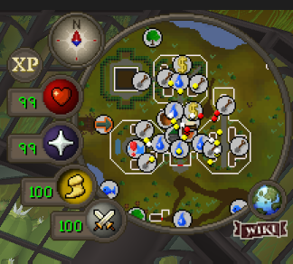
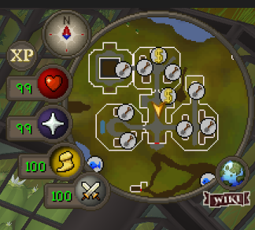
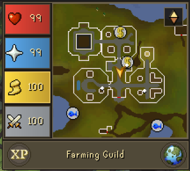
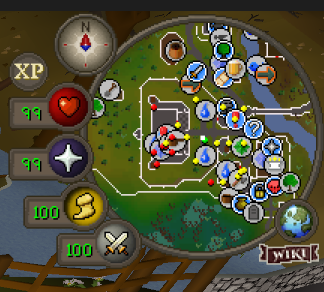
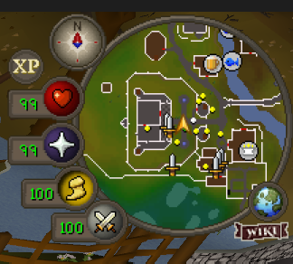
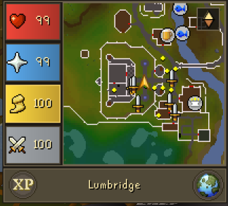

# Minimap Customizer

Customize your minimap! Change icons, remove clutter, go square, and much more.

## See the difference

**Turn this... into this. Or this.**

| Default | Filtered | Square HUD |
|:---:|:---:|:---:|
|  |  |  |

**Or this... into this. Or this.**

| Default | Filtered | Square HUD |
|:---:|:---:|:---:|
|  |  |  |

<strong>See what you want, how you want it.</strong>

## Features

- **Square HUD:** Prefer a more modern, modular layout? Revamp your minimap with a cleaner aesthetic. Customize the info panel to display time, zone, or coordinates.
- **Entity markers:** Choose how you, other players, NPCs, and ground items appear. Customize their colors or change their icons entirely.
- **Map icons:** Toggle banks, shops, skilling facilities, foliage, and other map icon categories independently to see only what you want.
- **Marker colors:** Customize native dots or color-code looting bag icons by the combined value of ground items on a tile.
- **Wilderness player skulls:** Display white skulls for players outside your combat range and red skulls for those within it. These icons do not indicate whether a player is actually skulled.
- **And more:** Check it out for yourself :)
